# Butaca · Proyecto Cine

Sistema web para un cine: cartelera pública, horarios, selección de sillas y compra de boletos, más un panel de administración con indicadores de taquilla. Es el proyecto final del curso de **Bases de Datos**, por lo que la mayor parte de las reglas del negocio viven en PostgreSQL (restricciones, disparadores, funciones y vistas).

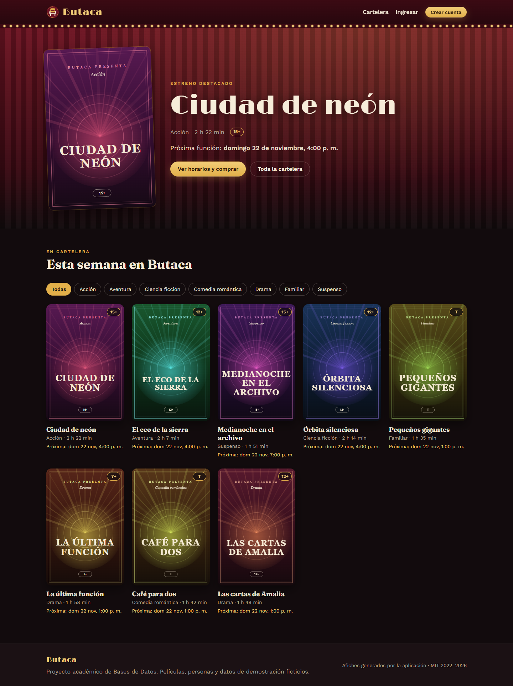

## Funcionalidades

**Público y clientes**

- Cartelera con filtro por género y afiches generados por la aplicación (SVG originales, sin material con derechos de autor).
- Ficha de película con dirección, reparto y funciones agrupadas por día, con sillas libres en tiempo real.
- Mapa de sillas por sala (estándar, preferencial, accesible) con total calculado en vivo y máximo 10 sillas por compra.
- Registro, inicio y cierre de sesión; descuento automático según el tipo de usuario (estudiante 20 %, adulto mayor 30 %).
- Compra atómica en la base de datos y comprobante tipo boleto; sección «Mis boletos» con próximas funciones e historial.

**Administración** (según permisos del rol)

- Resumen: ingresos y boletos de los últimos 7 días, ocupación promedio, películas más taquilleras y próximas funciones.
- Módulos de películas, directores, «Dirige», actores, reparto, salas, funciones, sillas, compras, boletos, medios de pago, usuarios, tipos de usuario, roles, permisos y permisos por rol, con búsqueda, orden por columna y paginación.
- Roles de ejemplo: **Administrador** (todo), **Taquilla** (solo ventas) y **Cliente** (compras en línea).

## Capturas

| | |
|---|---|
| 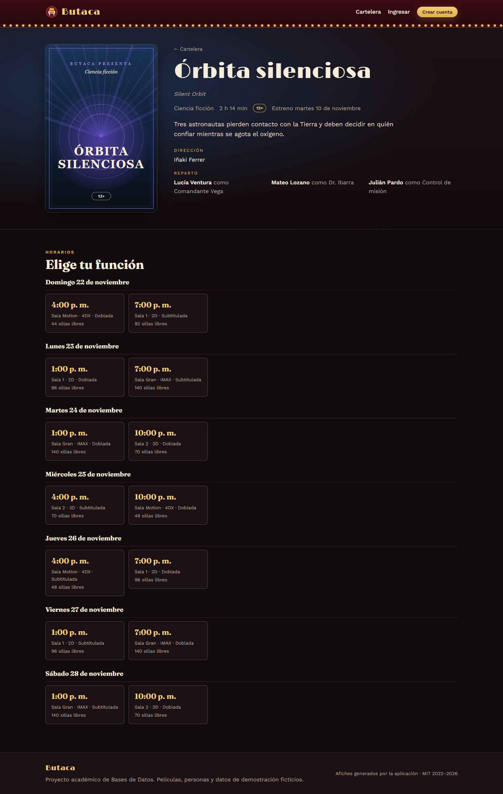 | 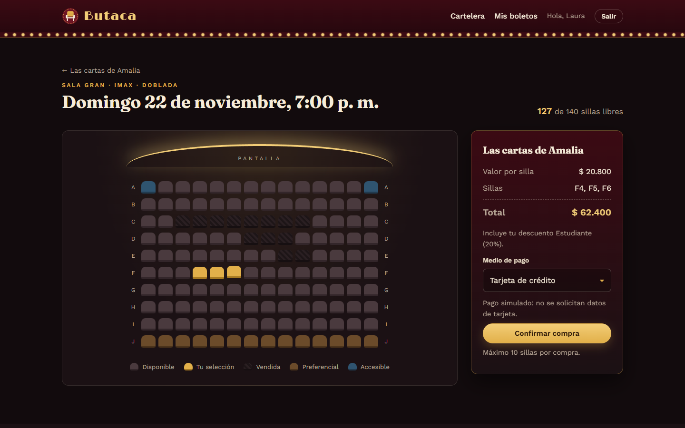 |
| 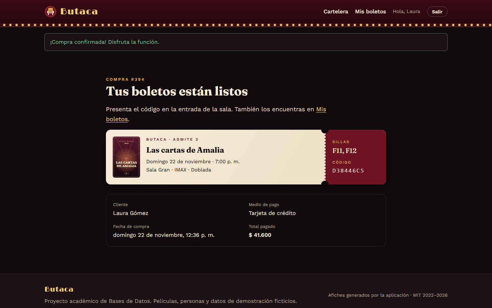 | 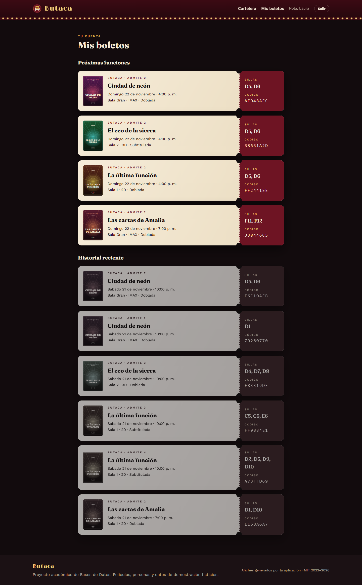 |
| 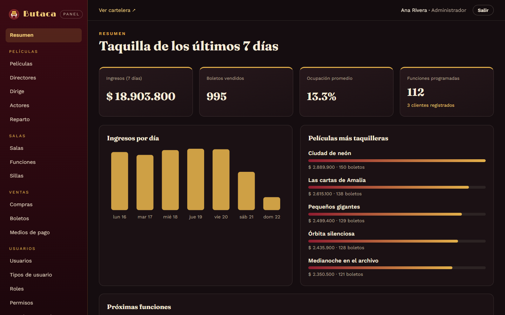 | 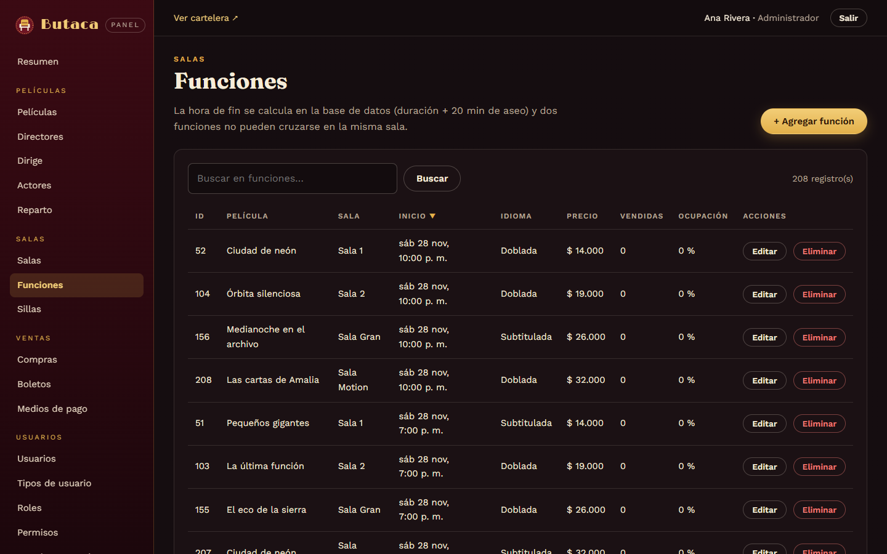 |
| 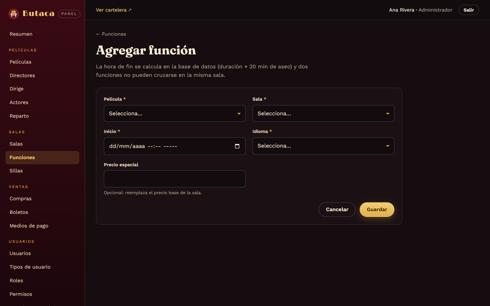 | 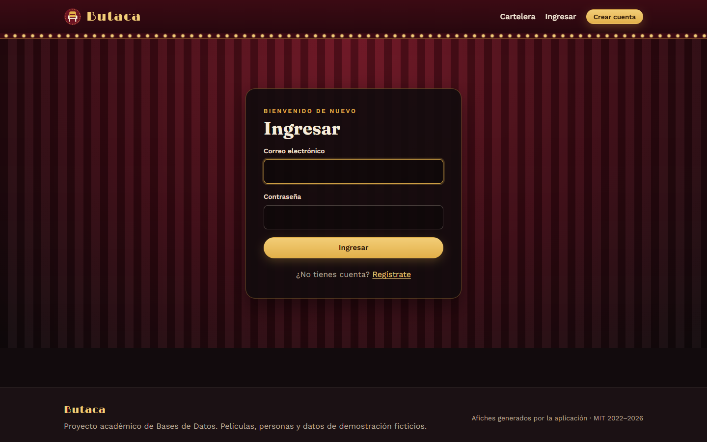 |

Versión móvil:

<p>
  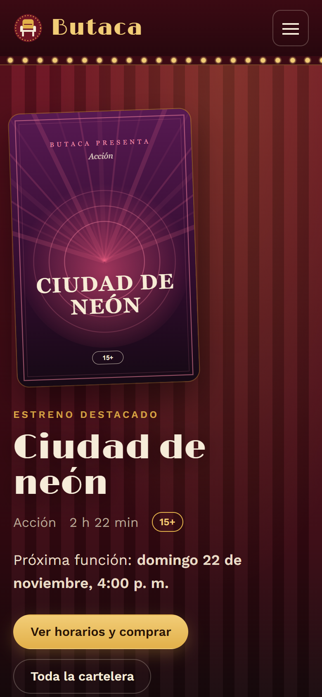
  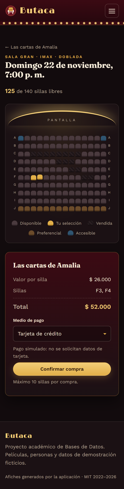
</p>

## Requisitos

- Docker y Docker Compose (recomendado), **o**
- PHP 8.3+ con `pdo_pgsql` y `mbstring`, Composer 2 y PostgreSQL 16.

## Ejecución con Docker

```bash
docker compose up -d --build
```

- Aplicación: <http://localhost:8140>
- PostgreSQL: `localhost:8141` (usuario `cine`, base `cine`)

Al arrancar, el contenedor `cine-web` aplica las migraciones pendientes y, con `APP_DEMO=1` (valor por defecto), carga los datos de demostración y programa funciones para los próximos 7 días. Para cambiar puertos o credenciales copie `.env.example` a `.env`.

Cuentas de demostración (solo para entornos locales):

| Rol | Correo | Contraseña |
|---|---|---|
| Administrador | `admin@butaca.test` | `Admin.2026` |
| Taquilla | `taquilla@butaca.test` | `Taquilla.2026` |
| Cliente (estudiante) | `laura@butaca.test` | `Cliente.2026` |
| Cliente (general) | `andres@butaca.test` | `Cliente.2026` |

Para detener y borrar todo (contenedores, red y volumen): `docker compose down -v`.

## Ejecución local sin Docker

```bash
composer install
cp .env.example .env          # ajuste DB_HOST, DB_PORT y credenciales
php bin/console migrate
php bin/console seed          # opcional: datos de demostración
php bin/console demo:schedule # opcional: funciones de la próxima semana
php -S localhost:8000 -t public
```

`php bin/console status` muestra las migraciones y semillas aplicadas o pendientes.

## Pruebas

62 pruebas con PHPUnit 12: unitarias (enrutador, CSRF, validación de formularios, registro de módulos, formato, afiches, traducción de errores, vistas) e integración contra PostgreSQL (esquema, disparadores, función de compra, CRUD genérico y prueba de humo de las páginas principales a través del núcleo HTTP). Las pruebas de integración reconstruyen una base `cine_test` desechable y cada prueba corre dentro de una transacción que se revierte.

```bash
# Con Docker (no requiere PHP local)
docker compose --profile test run --rm tests

# Local, con la base del compose levantada (docker compose up -d db)
composer test
```

## Arquitectura

```
public/            Front controller (index.php), CSS, JS y logo
src/
  App.php          Núcleo: servicios, rutas y Request → Response
  Http/            Request, Response, Router, Session, Csrf
  Auth/            Autenticación con bcrypt y límite de intentos
  Controller/      Sitio, compra de boletos, autenticación y panel
  Repository/      Consultas SQL parametrizadas por agregado
  Admin/           CRUD declarativo: Resource, Field, FormProcessor, CrudRepository
  Database/        Conexión PDO, migrador y traducción de errores SQLSTATE
  Poster/          Generador de afiches SVG
  Support/, View/  Formato en español y renderizado de plantillas
templates/         Vistas PHP (sitio, compra, autenticación, panel)
database/
  migrations/      001 esquema · 002 funciones · 003 disparadores · 004 vistas
  seeds/           001 datos de referencia · 002 programación y ventas de demo
bin/console        migrate · seed · demo:schedule · status
docker/            Dockerfile multi-etapa, Apache y entrypoint
tests/             Unit/ e Integration/
```

Es un MVC propio sin framework (como en la versión original del curso), ahora con autoload PSR-4 de Composer. Seguridad: consultas preparadas en todas partes (los identificadores SQL del CRUD solo salen de la definición de cada módulo), escape de toda salida con `e()`, token CSRF en todos los formularios, contraseñas con `password_hash`, regeneración del id de sesión al ingresar, cookies `HttpOnly`/`SameSite`, cabeceras CSP y credenciales por variables de entorno.

### Modelo de datos

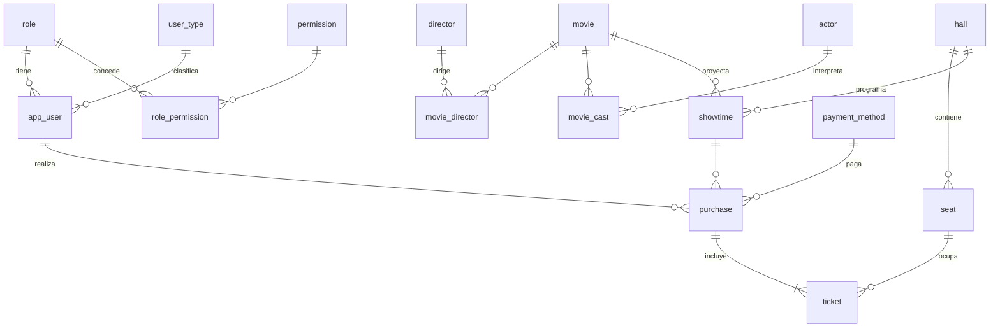

Elementos destacados de la base de datos:

- **Restricción de exclusión** (`btree_gist`): una sala no puede tener dos funciones cuyos horarios se crucen.
- **Unicidad** `(showtime_id, seat_id)` en `ticket`: una silla nunca se vende dos veces; clave foránea compuesta que obliga a que el boleto y su compra sean de la misma función.
- **Disparadores**: generación automática de sillas al crear o redimensionar una sala (bloqueado si ya hay ventas), hora de fin de la función (duración + 20 min de aseo), validación de que la silla pertenece a la sala y `updated_at`.
- **Funciones**: `fn_purchase_tickets` (compra completa y atómica con bloqueo de la función y códigos SQLSTATE propios `CN001`–`CN005`), `fn_ticket_price` (precio con descuento) y `fn_generate_seats`.
- **Vistas**: `v_user_detail`, `v_showtime_availability`, `v_movie_sales`, `v_purchase_detail` y `v_daily_revenue`, usadas por la aplicación y por el panel.
- Índices sobre claves foráneas y columnas de búsqueda, índice único sobre `lower(email)` y `CHECK` para formatos, rangos y catálogos.

## Contexto académico

Proyecto final de la asignatura Bases de Datos (2022), desarrollado originalmente por Kevin Santiago Martinez y Joshep Mateo Granada. La versión original era un MVC en PHP con PostgreSQL que solo implementaba los módulos de usuarios y roles, sin el esquema de base de datos en el repositorio. Esta versión 1.0.0 conserva el objetivo y el modelo del curso (usuarios, tipos, roles, permisos, películas, directores, actores, reparto, salas, funciones, sillas, boletos, pagos y tipos de pago) y lo completa: esquema versionado, datos de demostración, flujo de compra, panel administrativo, pruebas y despliegue con Docker. Todas las películas, personas y datos son ficticios; la marca «Butaca» es propia del proyecto.

## Licencia

[MIT](LICENSE) © 2022–2026 Kevin Martinez
